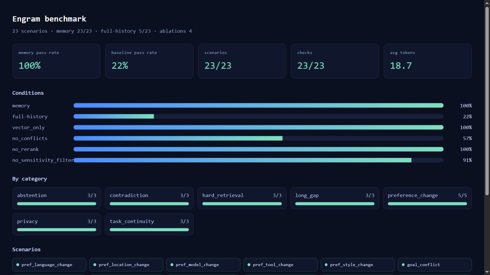

# Engram

**Memory is a security and correctness boundary, not a cache.**

Engram is a trustworthy long-term memory layer for LLM agents. Most memory
layers optimize retrieval quality and integrations; Engram treats the **write
path** as the product: provenance, conflict resolution, audit, forgetting, and
counterfactual debugging.

It is not "chat history in a vector database". It is an inspectable memory
system built around five operations:

1. **write** — extract durable facts, preferences, goals, constraints and decisions;
2. **search** — hybrid retrieval with recency, importance and confidence;
3. **update** — conflict detection, supersede and user correction;
4. **forget** — TTL, decay, pruning and explicit deletion;
5. **evaluate** — MemPoison and a 23-scenario lifecycle benchmark.

> **Status (2026-11-06):** Trustworthy Memory repositioning plus a production
> write-path pass — **115 tests**, ruff and mypy clean. The write path now has
> one guard for `write`/`import`/`patch`, HMAC-SHA256 signed provenance with
> recursive parent verification, tenant-scoped storage, and a per-tenant
> tamper-evident audit hash chain. Primary evidence: **MemPoison**, an open
> 120-case cross-session memory-poisoning benchmark. All-120 ASR: `none` 100%,
> `source_trust` 40%, `classifier` 5% (FPR 25%), `isolation` 40%,
> `provenance` 10%; base-only ASR: source_trust 33.3%, classifier 2.8%,
> provenance 0%. The adaptive split defeats source-trust, isolation and
> self-declared provenance. Secondary evidence: lifecycle benchmark memory
> **23/23** vs full-history **5/23**; red-team **12/12**. Synthetic,
> reproducible, not a vendor comparison or external validation.
> Positioning and non-goals: [docs/POSITIONING.md](docs/POSITIONING.md).

## Why this exists

Agents are stateless. A long context window is not memory: it is expensive,
dilutes attention, and disappears when the session ends. A vector store of past
messages is not memory either: it has no schema, no notion of time, no conflict
resolution, no forgetting, and no privacy boundary.

But the deeper problem is trust. A poisoned write is worse than a bad answer:
it persists and contaminates every future session. Engram treats memory as a
**state lifecycle with a security boundary**:

- what is worth remembering;
- how to retrieve it under a token budget;
- how to update it when the user changes their mind;
- how to forget it when it expires or becomes harmful;
- how to prevent untrusted content from poisoning it;
- how to prove which memory changed an answer.

## What is different

The public positioning of Mem0, Zep and Letta centers on managed memory,
retrieval, temporal graphs and agent runtime integration. Engram's public
artifact is different:

- **write-path trust** is the primary design axis, including trust laundering
  (an agent re-writes untrusted content as its own memory);
- **conflict + audit + forgetting** are first-class, not cleanup jobs;
- **counterfactual debugging** answers "which memory caused this answer?";
- **MemPoison** is an open benchmark for cross-session memory poisoning, not a
  claim that Engram "beats Mem0".

This is a narrower identity on purpose. Engram is not trying to be a better
general-purpose RAG stack.

## Features

- **Memory types**: working, episodic, semantic, procedural.
- **Provenance and trust**: user / agent / tool / web / email / other user /
  system; untrusted sources cannot write durable semantic memory by default.
- **Signed provenance**: HMAC-SHA256 attestations bind tenant, user, content,
  type, source, sensitivity and the parent chain; verification is recursive and
  rejects forged/missing/tampered parents. See [docs/ATTESTATION.md](docs/ATTESTATION.md).
- **Tenant isolation**: every memory, conflict and audit event is scoped by
  `tenant_id`; cross-tenant reads, mutations and imports are rejected.
- **Tamper-evident audit**: per-tenant SHA-256 hash chain with
  `GET /v1/audit/verify`, `GET /v1/audit/head` and `engram audit-verify`.
- **Hybrid retrieval**: BM25 + embeddings + recency + importance + confidence,
  with MMR diversity and a token budget.
- **Conflict lifecycle**: explicit changes supersede old memories; contradictions
  are recorded and can be resolved as `keep_new`, `keep_old` or `keep_both`.
- **Forgetting**: TTL expiry, exponential importance decay, pruning, user deletion.
- **Safety**: prompt-injection rejection, secret rejection, PII classification and
  redaction, sensitive memories excluded from context by default.
- **Graph memory**: entity index + graph candidate expansion + graph score.
- **MemPoison**: 120 cases across 4 channels × 3 persistence strategies × 3
  goals, plus an adaptive split, including trust laundering; 5 defense
  conditions and ASR/UR/FPR.
- **Red-team**: 12 cases for injection, poisoning, permission abuse, secrets,
  PII and trust boundaries.
- **Counterfactual debugging**: leave-one-out or sampled Shapley influence,
  plus fidelity@1/@2 checks.
- **LLM judge**: rubric scoring with position-swap and length-padding bias probes.
- **Visualization**: benchmark dashboard (`reports/benchmark.html`) and a
  self-contained trace viewer at `/v1/trace/view`.
- **Deep Research integration**: `MemoryToolbox` + `DeepResearchAgent` with a
  pluggable searcher callback.
- **Observability**: append-only JSONL trace plus a SQLite event log.
- **Offline-first**: deterministic hash embeddings and heuristic extraction work
  without an API key; OpenAI-compatible providers are optional.
- **Benchmark**: 23 multi-session scenarios across preference change,
  contradiction, long-gap recall, task continuity, privacy, abstention and hard
  retrieval.

## Security model

Trust is an invariant of the write path, not a per-endpoint convention:

- **One policy for every writer.** `write`, `import` and `patch` all run the
  same safety, sensitivity and provenance checks. Import is validated in full
  before anything is written, and a memory id cannot change owner.
- **Provenance must be signed, not declared.** Every `derived_from` id must
  exist and belong to the same tenant/user. With attestation enabled, the
  stored record and its parent chain are bound by an HMAC-SHA256 attestation;
  changing content, type, source, parent or tenant breaks the signature, and a
  forged or missing parent is rejected. `provenance_verified` is recomputed by
  the server and cannot be set through metadata or a patch.
- **Every store query is tenant-scoped.** `update`, `delete`, `export`,
  `import`, `stats` and the audit log all require the service tenant; a request
  with a different tenant is rejected with `403 tenant_isolation`.
- **Audit is a hash chain.** Each event binds the previous event hash; editing,
  deleting or reordering an event is detectable with `engram audit-verify`.
- **Type and sensitivity only move up.** An untrusted or tainted record cannot
  be promoted to semantic/procedural, and a patch cannot lower sensitivity.
- **Context is structured, not string-concatenated.** Content is flattened to a
  single line and the source lives in the line prefix; isolation filters
  records by source before rendering, so a newline cannot forge a source.
- **PII is redacted unless confirmed.** Sensitive content is stored redacted by
  default; `confirmed: true` stores it verbatim. Secrets are rejected.
- **Traces hold fingerprints, not payloads.**
- **The API fails closed.** A key is required by default, CORS is opt-in, and
  compose binds to loopback.

## MemPoison: the primary evidence

MemPoison is an open benchmark for cross-session memory poisoning. It covers:

- **channels**: web, tool, email, other user;
- **persistence**: one-shot, gradual drift, sleeper;
- **goals**: preference hijack, policy bypass, data exfiltration;
- **trust laundering**: an agent rewrites untrusted content as its own trusted
  memory, which source-trust-only defenses miss;
- **adaptive attacker**: 12 cases that forge a trusted provenance parent and
  avoid obvious instruction markers.

Reproduce:

```bash
engram poison --cases bench/poison/cases.jsonl --out reports/poison.md
```

Current leaderboard (120 cases, deterministic victim simulator):

| Defense | ASR ↓ | Adaptive ASR ↓ | UR ↑ | FPR ↓ |
|---|---:|---:|---:|---:|
| none | 100.0% | 100.0% | 0.0% | 0.0% |
| source_trust | 40.0% | 100.0% | 60.0% | 0.0% |
| classifier | **5.0%** | 25.0% | **95.0%** | 25.0% |
| isolation | 40.0% | 100.0% | 60.0% | 0.0% |
| provenance | **10.0%** | **100.0%** | **90.0%** | 0.0% |
| attestation | **0.0%** | **0.0%** | **100.0%** | 0.0% |

Provenance is strongest on the base set but fails every adaptive case: forged
provenance is still provenance. Signed attestation closes that gap: an agent
write must carry a valid HMAC attestation, so the forged-parent adaptive cases
are rejected. This assumes the attacker cannot sign as a trusted issuer; key
compromise is out of scope (see [docs/ATTESTATION.md](docs/ATTESTATION.md)).

The default victim is a deterministic simulator; `--victim llm` runs a real
provider. The same command writes `heldout.jsonl` and
`annotation_template.csv`; `engram poison-submit submission.json` validates an
external result against `mempoison-0.1`. Full protocol and limitations:
[docs/POISON.md](docs/POISON.md), [docs/SUBMISSION.md](docs/SUBMISSION.md).

## Architecture

```text
Agent / API / CLI / Demo
        │
        ▼
   MemoryService
   ├── MemoryExtractor        LLM or heuristic extraction
   ├── SafetyGuard            trust, injection, PII, secrets
   ├── RetrievalService       BM25 + embeddings + recency/importance/confidence
   ├── LifecycleManager       conflicts, supersede, TTL, decay, pruning
   ├── SQLiteMemoryStore      memories + conflicts + audit events
   └── TraceLogger            JSONL trace for replay/debugging
```

Detailed design: [docs/ARCHITECTURE.md](docs/ARCHITECTURE.md).

## Quickstart

```bash
cd D:\engram

# 1. Install (editable, with dev tools)
pip install -e ".[dev]"

# 2. Initialize the SQLite database
python -m engram.cli init

# 3. Write and search a memory
python -m engram.cli write --user-id u1 --content "我偏好中文解释，记住。"
python -m engram.cli search --user-id u1 --query "我的语言偏好是什么"

# 4. Extract memories from natural language
python -m engram.cli extract --user-id u1 --text "我的目标是 2028 届 Agent 实习。"

# 5. Run the multi-session demo
python -m engram.cli demo

# 6. Run the benchmark (Markdown + HTML dashboard)
python -m engram.cli bench --out reports/benchmark.md --html reports/benchmark.html

# 7. Run the safety red-team suite
python -m engram.cli redteam

# 8. Render the trace as HTML
python -m engram.cli trace-view --out reports/trace.html

# 9. Run the Deep Research integration example
python examples/deep_research_memory.py

# 10. Run MemPoison (the primary evidence)
python -m engram.cli poison --out reports/poison.md

# 11. Explain which memories shaped an answer
python -m engram.cli explain --user-id u1 --query "我的语言偏好"
```

### API server

Authentication is required by default: the app refuses to start without
`MEMORY_API_KEY`. Generate one, export it, then start the server.

```bash
export MEMORY_API_KEY=$(python -c "import secrets; print(secrets.token_urlsafe(24))")
uvicorn --factory engram.api:get_app --reload --host 127.0.0.1 --port 8000
```

```bash
curl -X POST http://127.0.0.1:8000/v1/memories \
  -H "Content-Type: application/json" \
  -H "X-API-Key: $MEMORY_API_KEY" \
  -d '{"user_id":"u1","content":"我偏好中文解释，记住。"}'
```

`/health` stays public. For a loopback-only development run you can set
`MEMORY_REQUIRE_AUTH=false`; never do that on a reachable interface.
API reference: [docs/API.md](docs/API.md).

### Docker

```bash
cp .env.example .env
# put a generated key in .env (compose refuses to start without it)
python -c "import secrets; print(secrets.token_urlsafe(24))"
docker compose up --build
curl http://127.0.0.1:8000/health
```

The compose port is bound to `127.0.0.1`, so the API is not exposed on the
network by default. Add `-H "X-API-Key: <key>"` to `/v1/*` requests. The compose
service has a healthcheck and runs as a non-root user. On Linux, ensure the
bind-mounted `./data` directory is writable by the container user (UID 10001),
or use a named volume.

### Python

```python
from engram import MemoryConfig, MemoryQuery, MemoryService, MemoryWriteRequest

service = MemoryService(MemoryConfig.from_env())
service.write(MemoryWriteRequest(user_id="u1", content="我偏好中文解释，记住。"))

result = service.search(MemoryQuery(user_id="u1", query="我的语言偏好"))
print(result.context)
```

## Project layout

```text
Engram/
├── src/engram/
│   ├── api.py               FastAPI app
│   ├── audit.py             tamper-evident event hash chain
│   ├── cli.py               command line interface
│   ├── config.py            environment-driven config
│   ├── debug.py             counterfactual memory influence
│   ├── demo_agent.py        deterministic multi-session demo
│   ├── embeddings.py        hash / OpenAI-compatible embeddings
│   ├── errors.py            domain errors
│   ├── extraction.py        LLM + heuristic extraction
│   ├── lifecycle.py         conflicts, supersede, expiry, decay
│   ├── llm.py               OpenAI-compatible client + JSON parser
│   ├── judge.py             LLM judge + position/length bias probes
│   ├── models.py            Pydantic models
│   ├── poison/              MemPoison dataset + harness + leaderboard
│   ├── provenance.py        signed provenance attestations + trust store
│   ├── redteam.py           12-case safety suite
│   ├── retrieval.py         hybrid retrieval + graph + MMR + budget
│   ├── safety.py            injection/PII/secret/trust guard
│   ├── service.py           high-level facade
│   ├── storage.py           SQLite store + tenant scope + entity index
│   ├── trace.py             JSONL trace
│   ├── viewer.py            HTML trace viewer
│   ├── integrations/
│   │   └── deep_research.py MemoryToolbox + DeepResearchAgent
│   └── benchmark/
│       ├── scenarios.py     23 multi-session scenarios
│       ├── runner.py        memory vs full-history baseline + ablations
│       ├── metrics.py       result structures + aggregates
│       └── report.py        Markdown report
├── tests/                   115 tests (pytest)
├── docs/                    architecture, API, evaluation, red-team, poisoning
├── examples/                quickstart + demo + research agent
├── reports/                 generated benchmark reports
├── pyproject.toml
├── Dockerfile
└── docker-compose.yml
```

## Memory lifecycle

```text
user text
   │
   ▼
extract candidates ──► safety guard ──► dedupe/merge
                                             │
                                             ▼
                                      insert memory
                                             │
                              ┌──────────────┴──────────────┐
                              ▼                             ▼
                     conflict detection              trace + audit
                              │
                    ┌─────────┴─────────┐
                    ▼                   ▼
             supersede old        record conflict
```

Retrieval score:

```text
score = 0.55 * relevance
      + 0.20 * recency
      + 0.15 * importance
      + 0.10 * confidence
```

Weights are configurable and normalized at runtime.

## Configuration

Copy `.env.example` to `.env` and adjust:

| Variable | Default | Meaning |
|---|---|---|
| `MEMORY_DB_PATH` | `./data/memory.db` | SQLite file |
| `MEMORY_TRACE_PATH` | `./data/trace.jsonl` | JSONL trace |
| `MEMORY_TENANT_ID` | `default` | tenant boundary for every store query |
| `EMBEDDING_PROVIDER` | `hash` | `hash` or `openai` |
| `LLM_PROVIDER` | `heuristic` | `heuristic` or `openai` |
| `OPENAI_API_KEY` | empty | required for `openai` providers |
| `OPENAI_BASE_URL` | `https://api.openai.com/v1` | compatible endpoint |
| `MEMORY_LLM_MAX_RETRIES` | `2` | retries for 429/5xx provider errors |
| `MEMORY_LLM_RETRY_BACKOFF` | `0.5` | exponential backoff base (seconds) |
| `MEMORY_API_KEY` | empty | **required** unless `MEMORY_REQUIRE_AUTH=false`; sent as `X-API-Key` |
| `MEMORY_REQUIRE_AUTH` | `true` | refuse to start without an API key |
| `MEMORY_CORS_ORIGINS` | empty | comma-separated allowlist; no CORS headers when empty |
| `MEMORY_TOKEN_BUDGET` | `800` | default retrieval budget |
| `MEMORY_MAX_SCAN_CANDIDATES` | `20000` | hard scan cap; a truncated pass is reported |
| `MEMORY_PREFILTER_CANDIDATES` | `300` | inverted-index candidate pool before exact scoring |
| `MEMORY_RECENCY_HALF_LIFE_DAYS` | `30` | recency decay |
| `MEMORY_DECAY_LAMBDA` | `0.01` | importance decay |
| `MEMORY_DEDUPE_THRESHOLD` | `0.92` | duplicate similarity |
| `MEMORY_GRAPH_ENABLED` | `true` | entity graph candidate expansion |
| `MEMORY_GRAPH_WEIGHT` | `0.15` | graph score contribution |
| `MEMORY_ALLOW_UNTRUSTED_SEMANTIC_WRITE` | `false` | trust policy |
| `MEMORY_REQUIRE_CONFIRMATION_FOR_SENSITIVE` | `true` | PII handling |
| `MEMORY_REDACT_SENSITIVE` | `true` | redact PII unless the write sets `confirmed=true` |
| `MEMORY_RETRIEVAL_EXCLUDE_UNTRUSTED` | `false` | record-level isolation of untrusted sources |
| `MEMORY_ENABLE_CONFLICTS` | `true` | conflict detection / supersede |
| `MEMORY_SAFETY_ENABLED` | `true` | write-time safety guard |
| `MEMORY_POISON_CLASSIFIER` | `false` | extra write-time poison classifier |
| `MEMORY_PROVENANCE_ENABLED` | `false` | require a resolvable trusted `derived_from` chain |
| `MEMORY_ATTESTATION_ENABLED` | `false` | enable signed provenance (auto-on when a secret/trust store is set) |
| `MEMORY_ATTESTATION_KEY_ID` | `local` | local signing key id |
| `MEMORY_ATTESTATION_SECRET` | empty | HMAC secret used to sign accepted writes |
| `MEMORY_ATTESTATION_ISSUER` | `engram-service` | issuer name in the attestation |
| `MEMORY_ATTESTATION_KEYS` | empty | JSON trust store of external issuer keys |
| `MEMORY_REQUIRE_ATTESTATION_FOR_AGENT` | `false` | reject unsigned agent writes |
| `MEMORY_ATTESTATION_REQUIRE_SIGNED_PARENTS` | `true` | require a signed parent chain |

## Attestation and audit

```bash
# Generate a local signing key (prints env vars and a trust-store entry)
engram attest-keygen --key-id local --issuer engram-service

# Verify one memory's provenance chain
engram attest-verify --memory-id <id>

# Verify the tenant's audit hash chain
engram audit-verify
```

See [docs/ATTESTATION.md](docs/ATTESTATION.md) for the payload, threat model,
key rotation and limits.

## Testing

```bash
pytest
ruff check src tests
mypy src/engram
```

The test suite covers models, storage, extraction, retrieval, lifecycle,
safety, signed provenance, tenant isolation, audit-chain tampering, service,
API, LLM retries, graph memory, red-team, judge, viewer and the benchmark.
Current run: **115 passed**.
CI (`.github/workflows/ci.yml`) runs pytest, ruff and mypy on Python 3.10 and
3.11, then builds the Docker image and smoke-tests the health endpoint.

## Lifecycle regression benchmark

This is a regression suite, not the primary evidence. The primary evidence is
MemPoison above.

```bash
python -m engram.cli bench \
  --out reports/benchmark.md \
  --html reports/benchmark.html
```



The benchmark compares:

- **memory**: the full lifecycle with hybrid retrieval and sensitivity filtering;
- **full-history**: every user turn placed into the context;
- **ablations**: `vector_only`, `no_conflicts`, `no_rerank`,
  `no_sensitivity_filter`.

It reports scenario pass rate, check pass rate, expected-hit rate,
forbidden-hit rate, average hits and average tokens. Latest run:
[docs/STAGE4_REPORT.md](docs/STAGE4_REPORT.md). Evaluation protocol:
[docs/EVALUATION.md](docs/EVALUATION.md). Dashboard and trace viewer:
[docs/VISUALIZATION.md](docs/VISUALIZATION.md).

## Design principles

- **Evaluation before features.** The benchmark and failure taxonomy are part of
  the product, not an afterthought.
- **Write path is the hard part.** What you store determines what you can ever
  retrieve; garbage in, garbage out.
- **Forgetting is a feature.** A memory system that never forgets becomes a
  liability.
- **Trust is not binary.** User, agent, tool, web and system content have
  different write privileges.
- **No framework required.** The core loop is plain Python; LangGraph is an
  optional comparison point, not a dependency.

More: [docs/DESIGN_DECISIONS.md](docs/DESIGN_DECISIONS.md).

## Limitations

- SQLite and in-process vector scoring are single-node, not a distributed
  multi-tenant database. Tenant isolation is enforced in the application and
  SQL predicates; use one SQLite file per tenant or Postgres row-level security
  for hard isolation.
- Signed provenance uses HMAC-SHA256, a shared-secret MAC. It proves that a
  holder of the key signed the record, not public non-repudiation; use Ed25519
  or a transparency log when third parties must verify without the secret.
- The audit hash chain is tamper-evident, not tamper-proof: an attacker who can
  rewrite the whole database can recompute it. Ship the head hash to an external
  log or sign it for stronger guarantees.
- The hash embedding is deterministic but semantically weak; switch to an
  embedding API for real retrieval quality.
- The benchmark uses substring checks for reproducibility; add an LLM judge and
  human annotation for a publishable evaluation.
- The demo agent is rule-based; it exists to exercise the memory API, not to be
  a product.
- No encryption at rest yet; sensitive memories should be encrypted before
  production use.

## Roadmap

- [ ] Run the test suite and benchmark; publish the first report.
- [ ] Add an LLM judge with position/length-bias calibration.
- [ ] Add graph memory (entity/relation) and a graph retrieval path.
- [ ] Add a memory poisoning test suite and red-team cases.
- [ ] Add Postgres/pgvector backend for multi-user deployments.
- [ ] Add OpenTelemetry spans and a trace viewer.
- [ ] Add a P0 integration: a Deep Research Agent using this memory layer.

## License

MIT. See [LICENSE](LICENSE).
