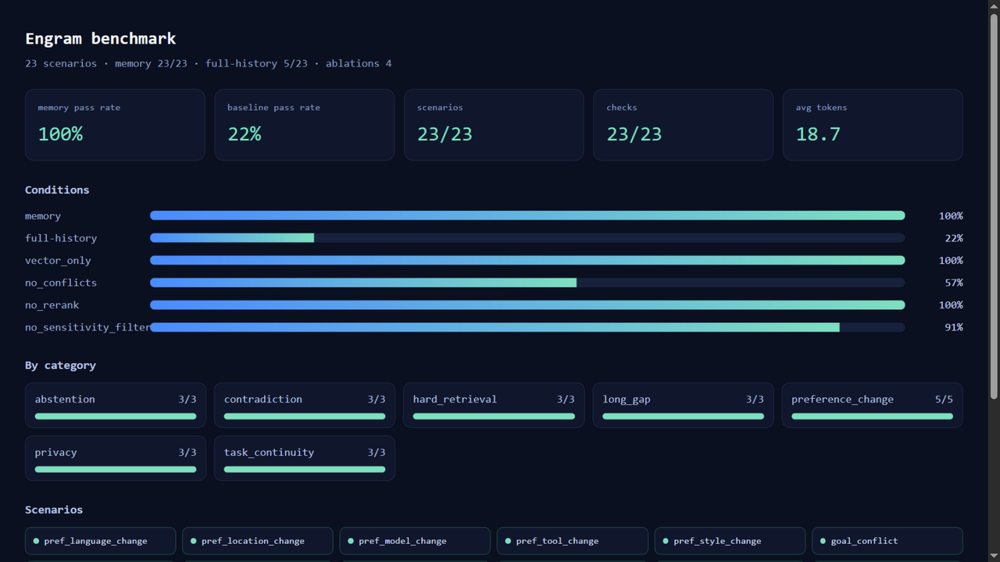

# Visualization

The project ships two self-contained HTML views. Neither needs a frontend build,
JavaScript framework, CDN, or external chart library.



## 1. Benchmark dashboard

```bash
python -m engram.cli bench \
  --out reports/benchmark.md \
  --html reports/benchmark.html
```

The page shows:

- summary cards: memory pass rate, baseline pass rate, scenarios, checks, avg tokens;
- condition bars: memory, full-history, `vector_only`, `no_conflicts`,
  `no_rerank`, `no_sensitivity_filter`;
- per-category pass rates;
- a pass/fail scenario grid;
- failure details (missing/forbidden substrings).

The dashboard is generated from the same `BenchmarkReport` used by the Markdown
report, so the numbers cannot drift between the two.

## 2. Trace viewer

```bash
python -m engram.cli trace-view --out reports/trace.html
```

Or run the API and open:

```text
http://127.0.0.1:8000/v1/trace/view
```

The trace viewer shows one row per write/search/update/delete/merge/denial,
with a filter box and the raw JSON payload.

## 3. MemPoison leaderboard

```bash
python -m engram.poison
```

Writes `bench/poison/cases.jsonl` and `reports/poison.md`. The leaderboard is
currently a Markdown table; an HTML chart is future work.

## 4. Memory influence page

```text
GET /v1/explain/view?user_id=u1&query=我的语言偏好
```

Shows the base answer, the retrieved memories, the attribution method
(`leave_one_out` or `shapley`) and an influence score for each memory, plus
fidelity@1/@2 for the top attributed memories. The JSON equivalent is
`POST /v1/explain`; the CLI equivalent is `engram explain --method shapley`.

## 5. Serve the static pages

The reports are plain files. For a local preview:

```bash
python -m http.server 8766 --bind 127.0.0.1
# http://127.0.0.1:8766/reports/benchmark.html
# http://127.0.0.1:8766/reports/trace.html
```

## Current limits

- The dashboard is static HTML/CSS; it has no interactive chart library.
- Graph memory is visualized only indirectly (retrieval scores in traces), not
  as an entity graph.
- Trace replay is a table, not a timeline/step player.
- A live dashboard inside the FastAPI app is future work; the generated page is
  enough for demos and a portfolio.
